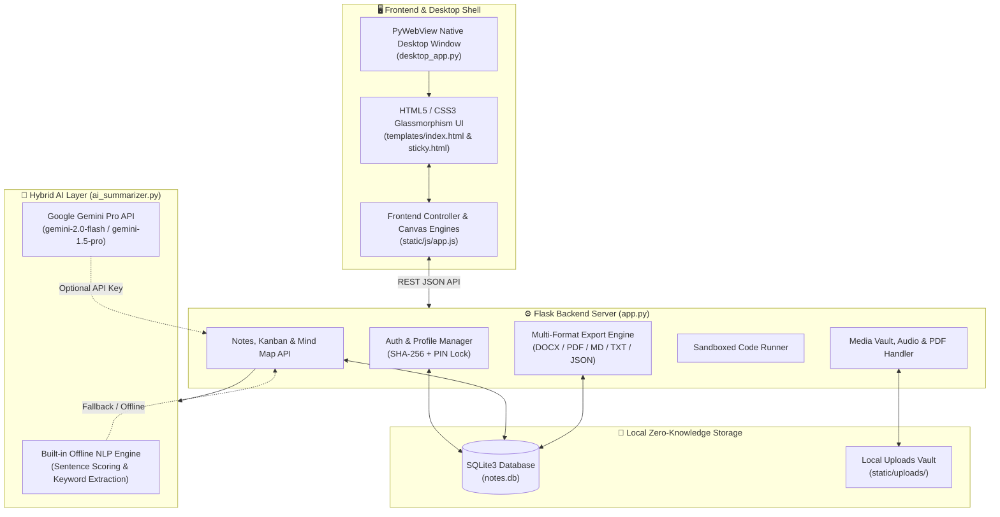

<div align="center">

<!-- ANIMATED HERO SVG BANNER -->


<br/>

<!-- ANIMATED TYPING SVG HEADER -->
<a href="https://git.io/typing-svg">
  
</a>

<br/>

<!-- SHIELDS.IO TECH & STATUS BADGES -->


<p align="center">
  <strong>NoteZ PRO (Smart Notes AI v2.0)</strong> is a full-featured, privacy-first desktop and web workspace engineered by <strong>Team NoCtraX</strong>.<br/>
  It combines a rich <strong>Visual WYSIWYG Canvas</strong>, <strong>Hybrid AI Summarization (Google Gemini Pro + Offline NLP)</strong>, <strong>Interactive Mind Maps</strong>, <strong>Kanban Task Boards</strong>, <strong>Academic Module Revision Packs</strong>, and <strong>Live Code Execution</strong> in a single unified interface.
</p>

[🚀 Quick Start](#-quick-start--installation) •
[✨ Key Features](#-core-features--modules) •
[🏗️ Architecture](#️-system-architecture) •
[⌨️ Shortcuts](#️-keyboard-shortcuts) •
[🔌 API Reference](#-rest-api-endpoints)

</div>


## 🌟 Why NoteZ PRO v2.0?

| Pillar | What Makes NoteZ Stand Out |
| :--- | :--- |
| 🎨 **Rich Visual Canvas** | MS Word-style WYSIWYG editing with fonts, colors, highlights, inline photo embeds, audio players with speed controls (`1x`–`2x`), PDF pills, and `[[Wiki Links]]`. |
| 🤖 **Dual-Engine AI Suite** | Works **100% offline** using the built-in TF/sentence-scoring NLP engine, or upgrades automatically to **Google Gemini Pro** when an API key is added. Includes an interactive **Ask AI Chat Drawer** & **QuillBot AI** launcher. |
| 🎓 **Academic & Study Hub** | Organize notes by Campus Subject Modules (`CS101`, `CS102`, etc.), generate **1-Click Exam Revision Packs**, and practice with **Interactive 3D Flip Flashcards**. |
| 🧠 **Visual Productivity** | Switch seamlessly between a force-directed **Interactive Mind Map Graph** (connecting notes, categories, and `[[Wiki Links]]`) and a drag-and-drop **Kanban Task Board**. |
| 🔐 **Privacy & Security** | Zero-knowledge local SQLite storage, individual **4-Digit PIN Note Locking**, JSON/PDF workspace backup bundles, and 1-click JSON restoration. |


## ✨ Core Features & Modules

### 1. 📝 Rich Visual Canvas & Raw Code Editor
- **Dual Editing Modes:** Toggle instantaneously between **Visual Canvas Mode** (WYSIWYG) and **Raw Markdown/HTML Mode**.
- **Full Formatting Suite:** Font family selector (`Outfit`, `Inter`, `Roboto`, `Fira Code`, `Playfair Display`, `Dancing Script`), font sizes (`10pt`–`48pt`), text & highlight color pickers, alignments, headings (`H1`–`H3`), checklists, and quotes.
- **Ready-Made Templates:** 1-click insertion for *🎓 Study Notes*, *💼 Meeting Minutes*, *📔 Daily Journal*, and *📋 Project Checklists*.
- **Floating Sticky Notes:** Pop out any note into a dedicated always-accessible desktop sticky window (`/sticky/<id>`).

### 2. 🤖 AI Summarizer, Chatbot & Smart Revision
- **Executive AI Insights:** Generates concise executive summaries, bulleted key action points, auto-suggested `#tags`, word counts, and estimated reading times.
- **Ask AI Chat Drawer:** Chat directly with your active note—generate 5-question MCQ quizzes, summarize in 3 bullets, or translate key concepts to Sinhala.
- **3D Flip Flashcards Deck:** Automatically converts your active note into an interactive 3D flip-card revision quiz.

### 3. 🧠 Mind Map Network & 📋 Kanban Task Board
- **Interactive Mind Map (`HTML5 Canvas`):** Visualizes notes, categories, and `[[Note Title]]` wiki connections with smooth physics, node dragging, glow effects, and click-to-open navigation.
- **Smart Kanban Board:** Drag-and-drop task management across **To-Do**, **In Progress**, and **Completed** columns with a live completion progress bar and instant task filtering.

### 4. 🎙️ Multimedia, OCR & Live Code Runner
- **🖼️ Smart Photo Vault:** Centralized media gallery showing all uploaded note images with file sizes, associated note titles, search filtering, and 1-click insertion.
- **🔍 OCR Image Text Extractor:** Scan uploaded screenshots or document photos and append extracted text directly into your note.
- **🎙️ Lecture Audio Recorder & Voice Dictation:** Record `.webm` audio directly from your microphone with an embedded multi-speed player (`1x`, `1.25x`, `1.5x`, `2x`), AI transcription, and real-time speech-to-text voice typing.
- **💻 Live Python/JS Code Runner:** Insert executable code blocks right inside your notes and run Python snippets live with captured `stdout` output.

### 5. 🎨 Dynamic Themes & Gamified Habit Tracking
- **5 Accent Palettes + Dark/Light Mode:** Switch between *🌊 Sky Blue*, *🌿 Mint Emerald*, *🔮 Royal Purple*, *🌸 Sunset Rose*, and *🟧 Warm Amber Gold*, plus toggleable **✨ Ambient Moving Stars & Shooting Meteors**.
- **🔥 7-Day Writing Streak & Analytics:** Track daily writing consistency with unlockable badges (*🥉 3-Day Novice*, *🥈 5-Day Pro Master*, *🥇 7-Day Legendary Scholar*) and a 7-day words-written Chart.js line graph.
- **📥 Universal Exports:** Export individual notes or full workspace bundles as **MS Word (`.doc`)**, **Themed PDF (`.pdf`)** (with 6 custom color palettes), **Markdown (`.md`)**, **Plain Text (`.txt`)**, or **JSON Backup (`.json`)**.


## 🏗️ System Architecture




## 📂 Project Structure

```text
NoteZ-App/
├── app.py                     # Main Flask backend server & REST API endpoints
├── desktop_app.py             # Native Windows desktop launcher (PyWebView + dynamic port)
├── ai_summarizer.py           # Hybrid AI Summarizer (Google Gemini API + Offline NLP fallback)
├── generate_icon.py           # Utility script to generate app_logo.png and app_icon.ico
├── make_shortcut.py           # Creates a native Windows Desktop shortcut (.lnk)
├── Notes.bat                  # 1-Click Windows batch launcher
├── LaunchApp.vbs              # Console-free silent Windows VBScript launcher
├── requirements.txt           # Python package dependencies
├── Procfile                   # Gunicorn configuration for cloud deployment
├── vercel.json                # Vercel serverless deployment configuration
├── templates/
│   ├── index.html             # Main workspace single-page application UI
│   └── sticky.html            # Pop-out floating desktop sticky note UI
└── static/
    ├── css/
    │   └── style.css          # Glassmorphism styles, dark mode, & 5 color palettes
    ├── js/
    │   └── app.js             # Frontend state, WYSIWYG canvas, Mind Map, Kanban, & AI logic
    ├── images/
    │   ├── app_icon.ico       # Application window icon
    │   ├── app_logo.png       # NoteZ brand logo
    │   ├── readme_banner.svg  # Animated SVG hero banner for GitHub README
    │   └── readme_divider.svg # Animated SVG section divider
    └── uploads/               # Ignored in Git (.gitkeep preserved for local media uploads)
```


## 🚀 Quick Start & Installation

### Prerequisites
- **Python 3.10+** installed on your system
- **Git** (optional, for cloning)

### 1️⃣ Clone the Repository
```bash
git clone https://github.com/your-username/notez-app.git
cd notez-app
```

### 2️⃣ Install Dependencies
```bash
pip install -r requirements.txt
```

### 3️⃣ Launch NoteZ PRO

#### 🖥️ Option A: Native Desktop Application (Recommended on Windows)
Runs Flask on a dynamically allocated local port inside a dedicated **PyWebView** desktop window:
```bash
python desktop_app.py
```
> 💡 **Windows 1-Click Launchers:** You can also double-click **`Notes.bat`** or **`LaunchApp.vbs`**, or run `python make_shortcut.py` once to generate a native `Smart Notes AI` shortcut with custom icon.

#### 🌐 Option B: Web Browser Mode
```bash
python app.py
```
Then open **`http://127.0.0.1:5000`** in your favorite browser.

---

### 🔑 Default Demo Login Credentials
On first launch, the SQLite database (`notes.db`) is automatically initialized with a clean demo profile and 4 sample academic modules (`CS101`–`CS104`).
- **Email:** `user@example.com`
- **Password:** `123456`
- *(Or click the **"⚡ 1-Click Demo Fill"** button on the login screen, or register a brand-new account!)*

### ✨ Enabling Google Gemini Pro AI (Optional)
1. Click the **⚙️ Settings** gear icon next to your profile in the sidebar.
2. Paste your **Google Gemini API Key** (`AIzaSy...`) in the **Profile** tab and click **Save Profile Settings**.
3. If left blank, NoteZ automatically uses its **Built-in Offline NLP Engine**—no internet or API key required!


## ⌨️ Keyboard Shortcuts

| Shortcut | Action |
| :--- | :--- |
| <kbd>Ctrl</kbd> + <kbd>S</kbd> | Save active note immediately |
| <kbd>Ctrl</kbd> + <kbd>K</kbd> | Focus global instant search bar |
| <kbd>Ctrl</kbd> + <kbd>B</kbd> | Toggle collapsible sidebar (Full Workspace View) / Bold text in editor |
| <kbd>Ctrl</kbd> + <kbd>I</kbd> | Italicize selected text in Visual Canvas |
| <kbd>Ctrl</kbd> + <kbd>U</kbd> | Underline selected text in Visual Canvas |
| `[[Note Title]]` | Create an interactive Wiki Link to another note (also connects in Mind Map) |


## 🔌 REST API Endpoints

<details>
<summary><strong>📂 Click to expand all Backend API Routes (<code>app.py</code>)</strong></summary>

<br/>

| Method | Endpoint | Description |
| :--- | :--- | :--- |
| `POST` | `/api/auth/register` | Register a new user profile |
| `POST` | `/api/auth/login` | Authenticate user and update daily writing streak |
| `POST` | `/api/auth/reset-password` | Reset user account password |
| `PUT` | `/api/auth/profile` | Update display name, avatar, cloud email, and Gemini API key |
| `GET` | `/api/auth/active-user` | Retrieve active/default user profile |
| `GET` | `/api/notes` | List notes (supports `filter`, `category`, `tag`, `search` query params) |
| `POST` | `/api/notes` | Create a new note |
| `GET` | `/api/notes/<id>` | Fetch single note (requires `X-Note-PIN` header if locked) |
| `PUT` | `/api/notes/<id>` | Update note content, metadata, color, reminder, or subject module |
| `DELETE` | `/api/notes/<id>` | Move note to Trash, or permanently delete if already in Trash |
| `DELETE` | `/api/notes/empty-trash` | Permanently delete all trashed notes |
| `POST` | `/api/notes/<id>/pin` | Toggle pinned status |
| `POST` | `/api/notes/<id>/favorite` | Toggle favorite star status |
| `POST` | `/api/notes/<id>/lock` | Lock or unlock a note with a 4-digit PIN |
| `POST` | `/api/notes/<id>/verify-pin` | Verify PIN code for a protected note |
| `POST` | `/api/ai/summarize` | Generate AI summary, key points, and tags (Gemini Pro or Offline NLP) |
| `POST` | `/api/ai/chat` | Ask AI questions about the active note |
| `POST` | `/api/ai/flashcards` | Auto-generate Q&A flashcards from note content |
| `GET` | `/api/graph/data` | Get nodes and edges for the Interactive Mind Map |
| `GET` | `/api/kanban/data` | Get notes grouped by `todo`, `in_progress`, and `completed` |
| `POST` | `/api/kanban/update` | Move note card between Kanban status columns |
| `GET` | `/api/subjects` | List academic subject modules with note & photo counts |
| `POST` | `/api/subjects/create` | Create a new academic subject module |
| `GET` | `/api/subjects/<code>/revision` | Generate consolidated Exam Revision Pack for a module |
| `GET` | `/api/gallery/images` | List all uploaded photos in the Photo Vault |
| `POST` | `/api/ocr/extract` | Upload image and extract text via OCR |
| `POST` | `/api/audio/upload` | Save recorded `.webm` lecture audio |
| `POST` | `/api/code/run` | Execute Python/JS code snippet and return output |
| `GET` | `/api/export/<id>` | Export note as themed `.pdf`, `.md`, or `.txt` |
| `GET` | `/api/notes/<id>/export/docx` | Export note as Microsoft Word `.doc` document |
| `GET` | `/api/backup` | Download full workspace JSON backup |
| `POST` | `/api/cloud-backup/restore` | Restore workspace notes from a `.json` backup file |

</details>


## 🛡️ Security & Git Privacy By Design

This repository is pre-configured with a strict [`.gitignore`](.gitignore) so personal data never leaks when pushing to GitHub:
- **Local Databases Excluded:** `*.db`, `*.sqlite`, `*.sqlite3` are ignored; a clean database is auto-generated on first run.
- **Personal Media Excluded:** `static/uploads/*` is ignored (while preserving `static/uploads/.gitkeep` so the folder structure stays intact).
- **Environment & Shortcuts Excluded:** `.env`, `*.lnk`, `.vscode/`, and `__pycache__/` are blocked from version control.

---

<div align="center">

### ⚡ Engineered by **Team NoCtraX**
*Cybersecurity • AI Engineering • Modern Desktop Architecture*

**Crafted with ❤️ | All Rights Reserved © 2026**

</div>
